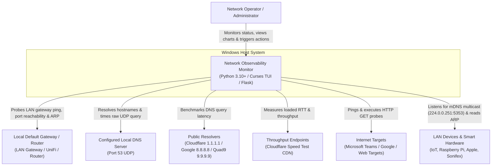
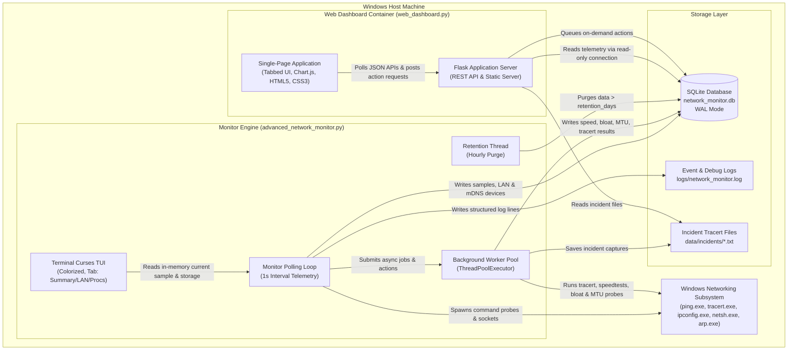
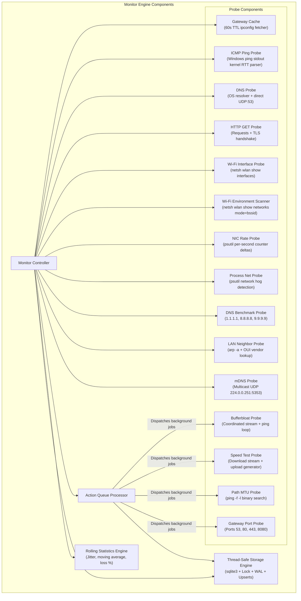

# Network Observability Monitor

Windows-only Python tool for continuous network health monitoring and observability. Probes internet connectivity, gateway responsiveness, DNS resolution (system resolver and direct UDP), HTTP reachability, Wi-Fi metrics across all adapters, NIC throughput and errors for every active interface, active network-hogging processes, TCP connection states, LAN ARP neighbor devices with hardware OUI vendor lookup, mDNS / Bonjour / ZeroConf smart device discovery, Path MTU & fragmentation diagnostics, and system CPU/RAM on a configurable interval. Runs periodic and on-demand bufferbloat scans, speed tests, and multi-DNS benchmarks. Persists all telemetry to SQLite with WAL mode, thread-safe access, and automatic retention enforcement. Provides a curses terminal TUI with color themes and view switching, alongside a rich, tabbed real-time web dashboard.

---

## 🌟 Key Features

- 📶 **Accurate Sub-Millisecond Telemetry**: Probes internet ping (ICMP RTT parsed directly from Windows kernel response), gateway ping, system DNS resolver time, direct UDP port 53 DNS server latency, and HTTP/TLS latency.
- 🌐 **LAN ARP Neighbor Discovery & Hardware OUI Lookup**: Continuously maps active devices on the local subnet via kernel ARP tables, classifying devices (Gateway vs Host) and identifying manufacturers (UniFi, Raspberry Pi, Apple, Sonifex, Intel, etc.).
- 📻 **mDNS / Bonjour / ZeroConf Smart Device Discovery**: Listens for multicast announcements (`224.0.0.251:5353`) to automatically identify smart TVs, IoT hardware, AirPlay endpoints, NAS units, printers, and workstations.
- 📏 **Path MTU & Packet Fragmentation Diagnostics**: Performs binary search ICMP testing (`ping -f -l`) to discover maximum unfragmented transmission units (MTU 1500 vs 1492 PPPoE/VPN) and tests gateway management ports (53, 80, 443, 8080).
- ⚡ **Unified Single-Process Mode**: Run both the background monitor and the web dashboard simultaneously with a single command (`--web`).
- 🚀 **Automated Setup & Runner Script (`run_monitor.ps1`)**: Automated environment checker that validates Windows system tools, bootstraps a dedicated Python virtual environment (`.venv`), installs all dependencies, and launches the application.
- 🖱️ **Interactive On-Demand Actions**: Trigger Speed Tests, Bufferbloat Scans, LAN Scans, mDNS Discovery, Path MTU Diagnostics, Wi-Fi Spectrum Scans, DNS Benchmarks, or arbitrary target Traceroutes directly from the Web UI.
- 💻 **Network Hog Identification (Per-Process Bandwidth)**: Real-time sampling of top network-active processes and bandwidth consumers (`psutil`).
- 🌐 **Multi-DNS Benchmark & Health Comparison**: Compares your local ISP DNS against Cloudflare (`1.1.1.1`), Google (`8.8.8.8`), and Quad9 (`9.9.9.9`), offering actionable optimization recommendations.
- 📡 **Wi-Fi Channel Congestion & Spectrum Visualization**: Visual distribution of competing access points on 2.4 GHz and 5 GHz bands with intelligent non-overlapping channel recommendations.
- 🔒 **Thread-Safe WAL SQLite Persistence**: Safe multi-threaded writes and concurrent web dashboard reads backed by SQLite Write-Ahead Logging (`WAL`) with true `ON CONFLICT` upserts.
- ⏱️ **Non-Blocking Diagnostic Engine**: Long-running tests (speed tests, bufferbloat, traceroutes, MTU) execute in background worker threads, preventing monitoring loop freezes and false offline alarms.
- 📊 **Dual User Interfaces**:
  - **Colorized Curses TUI**: ANSI green/amber/red/cyan/magenta themes, hotkeys (`S`, `B`, `W`, `L`, `M`, `Q`), and view switching (`Tab` cycles Summary, LAN Devices, and Network Hog Processes).
  - **Tabbed Web Dashboard**: Responsive dark-mode interface organized into dedicated tabs (Telemetry, LAN & Devices, Wi-Fi & RF, Diagnostics, Events & Export, All Panels) with historical time-range filters (`5m`, `15m`, `1h`, `6h`, `24h`).

---

## 🚀 Quick Start Guide

The easiest way to run the monitor is via the included PowerShell runner script, which automatically verifies system prerequisites, creates a Python `.venv`, installs dependencies, and launches the monitor with the web dashboard:

```powershell
# Default: launches unified mode with Web Dashboard at http://127.0.0.1:5000
.\run_monitor.ps1

# Headless background mode (ideal for server/service use)
.\run_monitor.ps1 -Headless

# Custom web port and exposed on local network
.\run_monitor.ps1 -Port 8080 -ListenHost 0.0.0.0
```

---

## 🛠️ Manual Installation & Running

### Requirements
- Windows 10 or later
- Python 3.10+
- `ping`, `tracert`, `ipconfig`, `netsh`, `git` on system PATH

### 1. Installation
```bash
python -m venv .venv
.venv\Scripts\activate
pip install -r requirements.txt
```

### 2. Running the Application

#### Option A: Unified Single-Process Mode (Recommended)
Run both the monitor engine and web dashboard in a single process:
```bash
# Terminal TUI + Web Dashboard on http://127.0.0.1:5000
python advanced_network_monitor.py --web

# Headless background monitor + Web Dashboard
python advanced_network_monitor.py --headless --web --port 5000
```

#### Option B: Dual-Process Mode
Run the monitor and web dashboard independently in separate terminal windows:
```bash
# Terminal 1: Monitor engine
python advanced_network_monitor.py --headless

# Terminal 2: Web dashboard
python web_dashboard.py --port 5000
```

---

## 🏛️ Architecture & C4 Model

### C4 Level 1: System Context Diagram



---

### C4 Level 2: Container Diagram



---

### C4 Level 3: Component Diagram (Monitor Engine)



---

## 📁 Repository Layout

```
run_monitor.ps1               -- Automated setup, dependency installer & runner
advanced_network_monitor.py   -- Telemetry engine (TUI, headless, and unified --web mode)
web_dashboard.py              -- Web dashboard server & REST API
config/
  default.yaml                -- Application configuration
  schema.sql                  -- SQLite schema (applied automatically on first run)
data/
  sqlite/network_monitor.db   -- SQLite WAL database
  incidents/                  -- Incident tracert output captures
logs/
  network_monitor.log         -- Structured rotating event log
tests/
  test_network_monitor.py     -- Unit tests covering math, probes, storage, and API
requirements.txt              -- Python dependencies
.gitignore                    -- Git ignore patterns (ignores runtime DB and logs)
LICENSE                       -- MIT License
```

---

## 📊 Web Dashboard Tabs & Features

The web dashboard is organized into focused, responsive tabs:

1. **📊 Telemetry Tab**:
   - Real-time metrics grid: Internet Ping, Gateway Ping, DNS Resolver, DNS Direct UDP, HTTP Response, Packet Loss %, CPU %, RAM %, Probe Duration, Active Host, IP Address, DNS Server IP, and Active Network Interface.
   - History time-range selector (`5m`, `15m`, `1h`, `6h`, `24h`) dynamically updating all trend charts.
   - Interactive line charts: Latency History, DNS vs HTTP, DNS Resolver vs Server UDP, Packet Loss Rate, CPU & RAM, Interface Activity Timeline, Per-Adapter NIC Throughput, and Error/Drop rates.
   - Live TCP connection states stacked bar chart.
2. **🌐 LAN & Devices Tab**:
   - **Top Network Applications (Network Hogs)**: Real-time per-process network I/O and connection counts.
   - **LAN ARP Neighbor Devices**: Full device inventory of the local subnet showing IP, MAC, hardware manufacturer (OUI vendor lookup), adapter interface, role (Gateway vs Host), and last-seen timestamps.
   - **Discovered mDNS Devices**: Discovered smart devices, Bonjour services, AirPlay endpoints, and ZeroConf hostnames.
3. **📶 Wi-Fi & RF Tab**:
   - Current link details: SSID, BSSID, Signal % meter, Band & Channel, Rx/Tx link rates, Authentication & Cipher.
   - Wi-Fi signal strength history chart.
   - 2.4 GHz & 5 GHz channel congestion bar charts with automatic best-channel recommendations.
   - Full environment scan table of all visible neighbor BSSIDs.
4. **🔬 Diagnostics Tab**:
   - **Multi-DNS Latency Benchmark**: Side-by-side comparison of local ISP DNS vs Cloudflare, Google, and Quad9.
   - **Path MTU & Packet Fragmentation Diagnostics**: Discovered path MTU, maximum unfragmented ICMP payload size, PPPoE/VPN reduction detection, and gateway management port health (53, 80, 443, 8080).
   - **Bufferbloat History**: Measurement of latency inflation under load.
   - **Speed Test History**: Download and upload throughput charts and test log.
   - **Diagnostic Incidents**: Expandable log captures from automatic fault traceroutes.
5. **📜 Events & Export Tab**:
   - System and connectivity event log with color-coded severity badges.
   - Diagnostic incident viewer.
   - Data exporter for any database table (`samples`, `lan_devices`, `mdns_devices`, `mtu_samples`, `process_samples`, `dns_benchmarks`, etc.) as CSV or JSON over custom date ranges.
6. **📁 All Panels Tab**:
   - Unified view showing all monitoring cards simultaneously for single-screen observability.

---

## 🎮 Terminal Curses TUI Hotkeys

When running `advanced_network_monitor.py` interactively, the terminal curses TUI provides ANSI color themes and interactive controls:

| Hotkey | Action |
|:------:|:-------|
| `Tab`  | Cycle TUI views: `SUMMARY` &rarr; `LAN DEVICES` &rarr; `NETWORK HOG PROCS` |
| `S`    | Trigger on-demand Speed Test in background |
| `B`    | Trigger on-demand Bufferbloat Test in background |
| `W`    | Trigger immediate Wi-Fi Environment Scan |
| `L`    | Trigger immediate LAN ARP Subnet Scan |
| `M`    | Trigger immediate mDNS ZeroConf Discovery |
| `Q`    | Cleanly shutdown monitor and exit |

---

## ⚙️ Configuration Reference (`config/default.yaml`)

### `general`
| Key | Default | Description |
|-----|---------|-------------|
| `poll_interval_seconds` | `1` | Polling loop interval. Compensates sleep for probe duration. |
| `retention_days` | `14` | Deletes rows older than this hourly from all database tables. |
| `timezone` | `Europe/London` | Informational timezone label. |

### `thresholds`
| Key | Default | Description |
|-----|---------|-------------|
| `high_latency_ms` | `500` | Triggers `high_latency` fault badge. |
| `severe_latency_ms` | `1000` | Triggers `severe_latency` fault badge and diagnostic tracert. |
| `high_jitter_ms` | `50` | Triggers `high_jitter` fault badge. |
| `slow_dns_ms` | `750` | Triggers `slow_dns` fault badge. |
| `packet_loss_rate_pct` | `5` | Triggers `high_packet_loss` fault badge. |
| `nic_error_rate_ps` | `1.0` | Combined error/drop rate per second triggering `nic_errors`. |

### `diagnostics`
| Key | Default | Description |
|-----|---------|-------------|
| `traceroute_on_fault` | `true` | Executes non-blocking tracert on fault (rate-limited by 300s cooldown). |
| `slow_probe_multiplier`| `1.5` | Threshold multiplier for slow probe warnings. |

---

## 🧪 Running Automated Tests

Run the test suite with Python's built-in `unittest`:

```bash
python -m unittest discover -s tests -v
```

---

## 📄 License

Distributed under the [MIT License](LICENSE).
