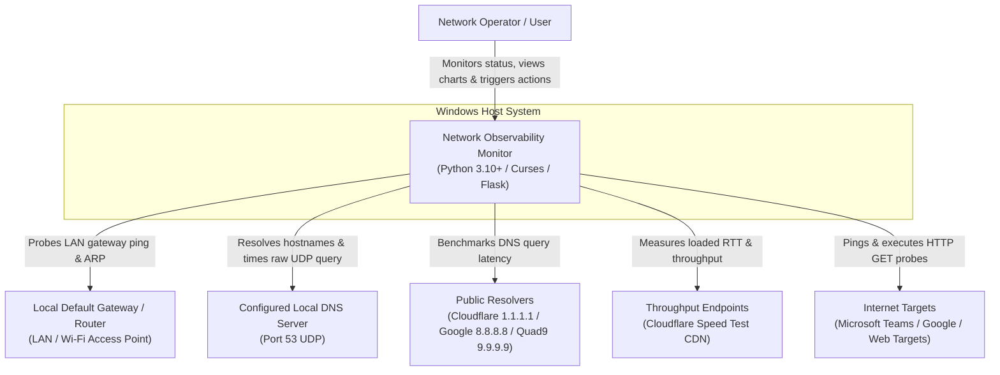
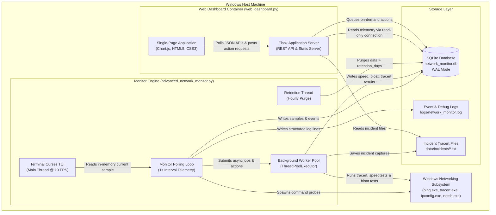
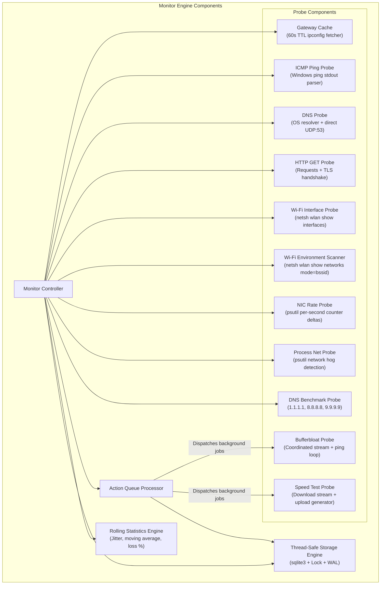

# Network Observability Monitor

Windows-only Python tool for continuous network health monitoring and observability. Probes internet connectivity, gateway responsiveness, DNS resolution (system resolver and direct UDP), HTTP reachability, Wi-Fi metrics across all adapters, NIC throughput and errors for every active interface, active network-hogging processes, TCP connection states, and system CPU/RAM on a configurable interval. Runs periodic and on-demand bufferbloat scans, speed tests, and multi-DNS benchmarks. Persists all telemetry to SQLite with WAL mode, thread-safe access, and automatic retention enforcement. Provides a curses terminal TUI and a rich real-time web dashboard.

---

## 🌟 Key Features

- 📶 **Accurate Sub-Millisecond Telemetry**: Probes internet ping (ICMP RTT parsed from Windows kernel response), gateway ping, system DNS resolver time, direct UDP port 53 DNS server latency, and HTTP/TLS latency.
- ⚡ **Unified Single-Process Mode**: Run both the background monitor and the web dashboard simultaneously with a single command (`--web`).
- 🚀 **Automated Setup & Runner Script (`run_monitor.ps1`)**: Automated environment checker that validates Windows system tools, bootstraps a dedicated Python virtual environment (`.venv`), installs all dependencies, and launches the application.
- 🖱️ **Interactive On-Demand Actions**: Trigger Speed Tests, Bufferbloat Scans, Wi-Fi Spectrum Scans, DNS Benchmarks, or arbitrary target Traceroutes directly from the Web UI.
- 💻 **Network Hog Identification (Per-Process Bandwidth)**: Real-time sampling of top network-active processes and bandwidth consumers (`psutil`).
- 🌐 **Multi-DNS Benchmark & Health Comparison**: Compares your local ISP DNS against Cloudflare (`1.1.1.1`), Google (`8.8.8.8`), and Quad9 (`9.9.9.9`), offering actionable optimization recommendations.
- 📡 **Wi-Fi Channel Congestion & Spectrum Visualization**: Visual distribution of competing access points on 2.4 GHz and 5 GHz bands with intelligent non-overlapping channel recommendations.
- 🔒 **Thread-Safe WAL SQLite Persistence**: Safe multi-threaded writes and concurrent web dashboard reads backed by SQLite Write-Ahead Logging (`WAL`).
- ⏱️ **Non-Blocking Diagnostic Engine**: Long-running tests (speed tests, bufferbloat, traceroutes) execute in background worker threads, preventing monitoring loop freezes and false offline alarms.
- 📊 **Dual User Interfaces**: Real-time curses terminal TUI with live Unicode sparklines (`advanced_network_monitor.py`) and a dark-mode responsive Chart.js Web Dashboard (`web_dashboard.py`).

---

## 🚀 Quick Start Guide

The easiest way to run the monitor is via the included PowerShell runner script, which automatically verifies system prerequisites, creates a Python `.venv`, installs dependencies, and launches the monitor with the web dashboard:

```powershell
# Default: launches unified mode with Web Dashboard at http://127.0.0.1:5000
.
un_monitor.ps1

# Headless background mode (ideal for server/service use)
.
un_monitor.ps1 -Headless

# Custom web port and exposed on local network
.
un_monitor.ps1 -Port 8080 -ListenHost 0.0.0.0
```

---

## 🛠️ Manual Installation & Running

### Requirements
- Windows 10 or later
- Python 3.10+
- `ping`, `tracert`, `ipconfig`, `netsh`, `git` on system PATH

### 1. Installation
```bash
python -m venv .venv
.venv\Scripts\activate
pip install -r requirements.txt
```

### 2. Running the Application

#### Option A: Unified Single-Process Mode (Recommended)
Run both the monitor engine and web dashboard in a single process:
```bash
# Terminal TUI + Web Dashboard on http://127.0.0.1:5000
python advanced_network_monitor.py --web

# Headless background monitor + Web Dashboard
python advanced_network_monitor.py --headless --web --port 5000
```

#### Option B: Dual-Process Mode
Run the monitor and web dashboard independently in separate terminal windows:
```bash
# Terminal 1: Monitor engine
python advanced_network_monitor.py --headless

# Terminal 2: Web dashboard
python web_dashboard.py --port 5000
```

---

## 🏛️ Architecture & C4 Model

### C4 Level 1: System Context Diagram



---

### C4 Level 2: Container Diagram



---

### C4 Level 3: Component Diagram (Monitor Engine)



---

## 📁 Repository Layout

```
run_monitor.ps1               -- Automated setup, dependency installer & runner
advanced_network_monitor.py   -- Telemetry engine (TUI, headless, and unified --web mode)
web_dashboard.py              -- Web dashboard server & REST API
config/
  default.yaml                -- Application configuration
  schema.sql                  -- SQLite schema (applied automatically on first run)
data/
  sqlite/network_monitor.db   -- SQLite WAL database
  incidents/                  -- Incident tracert output captures
logs/
  network_monitor.log         -- Structured rotating event log
tests/
  test_network_monitor.py     -- Unit tests covering math, probes, storage, and API
requirements.txt              -- Python dependencies
.gitignore                    -- Git ignore patterns (ignores runtime DB and logs)
LICENSE                       -- MIT License
```

---

## 📊 Web Dashboard Panels & Controls

- **Status Bar**: Live health status badge (OK / Warning / Fault / Stale indicator), DB size, sample count, and last sample timestamp.
- **On-Demand Actions Panel**:
  - `Run Speed Test`: Queues an immediate download/upload test in a background worker.
  - `Run Bufferbloat Test`: Measures loaded RTT against baseline in a background worker.
  - `Scan Wi-Fi Now`: Refreshes visible RF environment immediately.
  - `Benchmark DNS`: Probes local DNS against Cloudflare, Google, and Quad9.
  - `Traceroute Target`: Executes an on-demand traceroute to any custom host or IP.
- **Metrics Grid**: Internet ping, gateway ping, DNS resolver latency, DNS direct UDP latency, HTTP response time, packet loss rate %, CPU %, RAM %, probe duration, active host, primary IP, DNS server IP, and active network interface.
- **Top Network Applications (Network Hogs)**: Ranked list of active processes by network I/O and connection count.
- **Multi-DNS Latency Benchmark**: Side-by-side latency comparisons and recommendations.
- **Wi-Fi Channel Overlap & Congestion**: Graphical channel distribution across 2.4 GHz and 5 GHz bands with intelligent non-overlapping channel recommendations.
- **Live Charts**: Latency history, DNS comparison, packet loss rate, CPU/RAM utilization, Wi-Fi signal strength, and per-adapter throughput & error rate timelines.
- **Data Export**: Configurable time-window slice export for any database table as CSV or JSON.

---

## ⚙️ Configuration Reference (`config/default.yaml`)

### `general`
| Key | Default | Description |
|-----|---------|-------------|
| `poll_interval_seconds` | `1` | Polling loop interval. Compensates sleep for probe duration. |
| `retention_days` | `14` | Deletes rows older than this hourly from all database tables. |
| `timezone` | `Europe/London` | Informational timezone label. |

### `thresholds`
| Key | Default | Description |
|-----|---------|-------------|
| `high_latency_ms` | `500` | Triggers `high_latency` fault badge. |
| `severe_latency_ms` | `1000` | Triggers `severe_latency` fault badge and diagnostic tracert. |
| `high_jitter_ms` | `50` | Triggers `high_jitter` fault badge. |
| `slow_dns_ms` | `750` | Triggers `slow_dns` fault badge. |
| `packet_loss_rate_pct` | `5` | Triggers `high_packet_loss` fault badge. |
| `nic_error_rate_ps` | `1.0` | Combined error/drop rate per second triggering `nic_errors`. |

### `diagnostics`
| Key | Default | Description |
|-----|---------|-------------|
| `traceroute_on_fault` | `true` | Executes non-blocking tracert on fault (rate-limited by 300s cooldown). |
| `slow_probe_multiplier`| `1.5` | Threshold multiplier for slow probe warnings. |

---

## 🧪 Running Automated Tests

Run the test suite with Python's built-in `unittest`:

```bash
python -m unittest discover -s tests -v
```

---

## 📄 License

Distributed under the [MIT License](LICENSE).
